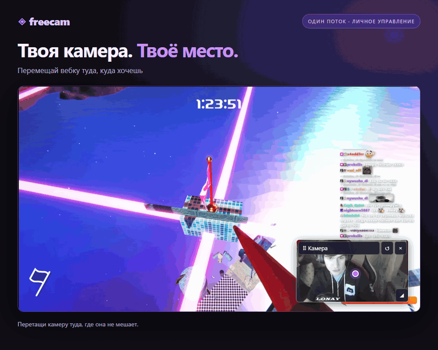
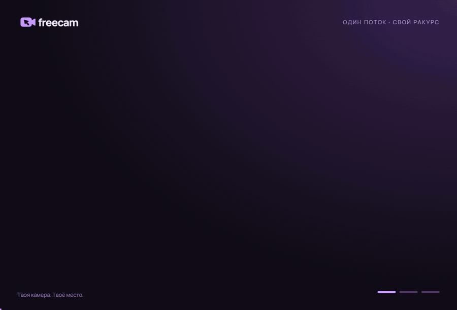
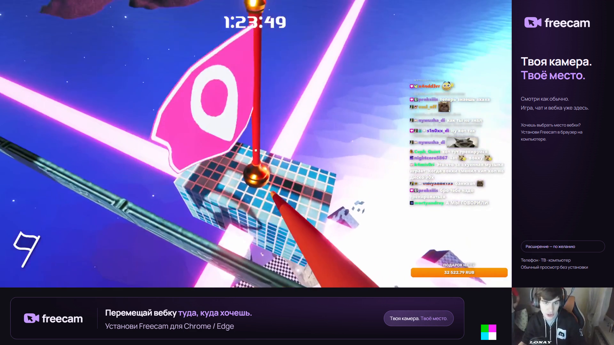

# Freecam — твоя камера, твоё место

**Камера стримера — в удобном месте у каждого зрителя. Один эфир, личный вид.**

Вебка закрывает мини-карту, субтитры или важный момент игры? Freecam позволяет перенести её в другой угол, изменить размер или скрыть. Настройки сохраняются в браузере и не меняют трансляцию для остальных.

- **Свободное положение.** Камера перемещается за панель ⠿.
- **Удобный размер.** Угловой маркер ◢ меняет размер с сохранением пропорций.
- **Свой вид.** Скрытие, возврат и сохранённые настройки отдельно для каждого канала.
- **Один поток.** Игра и камера передаются в общем кадре, без отдельной раздачи вебки.

> **Экспериментальное расширение Chrome/Edge.** Эта версия устанавливается в браузер, а не через каталог Twitch Extensions. Локальный прототип проверен; совместимость с живым Twitch ещё не подтверждена.

## Статус проекта

**Открытая бета.** Работа на живом Twitch целиком ещё не подтверждена. Не считайте локальные тесты гарантией совместимости с рекламой, DRM и всеми устройствами.

| Версия | Состояние |
|---|---|
| `main` / 0.2.2 | Стабильная линия прототипа; в этой ветке сейчас обновляется документация |
| [experimental](https://github.com/bimo0o/freecam-twitch/tree/experimental) / 0.3.0 | Исправление копирования сцены с нулевыми bounds, оформленный просмотр без расширения, подготовка магазинов |
| Магазины браузеров | Пакеты подготовлены в experimental; аккаунты издателя и модерация ещё впереди |
| Мобильная интерактивность | Не выпущена. Обычный просмотр доступен через Twitch |

[Скачать экспериментальную сборку Windows](https://github.com/bimo0o/freecam-twitch/releases/download/v0.3.0-experimental/Freecam-Streamer-Windows.zip) · [Код экспериментального расширения](https://github.com/bimo0o/freecam-twitch/tree/experimental/browser-extension)

## Один поток. Две области. Личный вид.

OBS размещает игру и камеру в разных частях одного кадра. Расширение в браузере отделяет эти области и показывает вебку поверх игры там, где удобно зрителю. Обе картинки берутся из одного снимка видеокадра; звук остаётся у исходного плеера.



[Демонстрация в MP4, 25 FPS](docs/assets/freecam-preview.mp4) · [Схема в MP4, 25 FPS](docs/assets/freecam-how-it-works.mp4)

## Что видит стример в OBS



Пример на демо-записях, собранный из актуальных ресурсов experimental. Вся сцена с игрой, чатом и виджетами вписана в основную область. Вебка отдельно снизу справа. Правая панель и нижняя анимированная подсказка видны при обычном просмотре; расширение показывает игру на весь плеер и подвижную вебку.

[Посмотреть анимированный пример выходного кадра](docs/assets/obs-preview.mp4)

## Быстрый старт

### Для зрителя

1. [Скачать Freecam](https://github.com/bimo0o/freecam-twitch/archive/refs/heads/main.zip) и распаковать архив.
2. На странице расширений Chrome или Edge включить **«Режим разработчика»**, выбрать **«Загрузить распакованное»** и указать папку **`browser-extension`**.
3. Открыть на **twitch.tv** канал со специальной компоновкой Freecam.
4. Freecam автоматически распознает подготовленный поток и включит управление камерой.

Это расширение браузера: его значок находится рядом с адресной строкой, в меню расширений (пазл). В меню Twitch-плеера его нет. Публикация в магазинах Chrome/Edge пока не выполнена; текущая установка — тестовая.

Панель **⠿** перемещает камеру, **◢** меняет размер, **×** скрывает, **↺** возвращает исходное положение. Кнопка **«Показать камеру»** возвращает скрытую вебку. **«Вернуть оригинальный плеер»** выключает обработку.

### Для стримера

1. [Скачать приложение для Windows](https://github.com/bimo0o/freecam-twitch/releases/download/v0.2.2-streamer-preview/Freecam-Streamer-Windows.zip), распаковать архив и открыть **`Freecam Setup.exe`**. Node.js и установка проекта не нужны; мастер откроется в браузере.
2. В OBS открыть **Tools / Сервис → WebSocket Server Settings / Настройки сервера WebSocket**. Включить **Enable WebSocket server / Включить сервер WebSocket**, оставить авторизацию включённой.
3. Скопировать **Server Password / Пароль сервера** из OBS, вставить в поле **«Пароль OBS»** в мастере и нажать **«Подключить OBS»**.
4. Выбрать **сцену для копирования** и источник вебки → **«Подготовить и открыть сцену»**. Чат, виджеты и оформление переносятся вместе с игрой.

Freecam создаст отдельную копию композиции и впишет её целиком в область стрима. Камера будет вынесена отдельно, а короткая анимированная подсказка установки останется в нижней полосе. Исходная сцена и холст 16:9 сохранятся; выход OBS настраивается на 1080p. Координаты и разрешение проверяются автоматически. При активном эфире или записи подготовка не запускается; трансляция автоматически не включается.

Подсказка **«Установите Freecam»** видна в исходном кадре. У зрителя с включённой обработкой эта область не показывается.

Это переносимое приложение для Windows 10/11 с системным .NET Framework 4.8. После подготовки приложение можно закрыть. Один раз включить WebSocket в OBS и выбрать сцену и камеру всё ещё необходимо.

**[Пошаговая инструкция: от запуска до готовой сцены →](docs/STREAMER-QUICKSTART.md)**

[Проверка эфира на Twitch →](docs/STREAM-TEST.md)

### Попробовать без эфира

Локальное демо показывает анимированную вебку и эталон рядом. Номера **FRAME** позволяют сравнить их синхронность, а короткий звуковой импульс повторяется каждые две секунды.

Нужны Node.js 22.12+, FFmpeg и Microsoft Edge на Windows. [Другие варианты запуска](docs/SINGLE-STREAM.md#открыть-локальный-тест).

```powershell
git clone https://github.com/bimo0o/freecam-twitch.git
cd freecam-twitch
npm ci
npm run demo:sync
npm run dev
```

**[Открыть локальное демо](http://127.0.0.1:5173/packed.html?demo=1&sync=1&compose=1)**

## Телефон, телевизор и просмотр без установки

**Устанавливать расширение для просмотра стрима не обязательно.** Без него зритель видит общий кадр OBS в обычном Twitch-плеере: игру, чат, вебку и оформление. В experimental пустая правая область заменена аккуратной панелью. Переносить вебку в этом режиме нельзя; основная картинка занимает часть 1080p-кадра.

| Где смотрят | Обычный просмотр | Свободное положение вебки |
|---|---|---|
| Компьютер, Chrome / Edge | Да | С расширением, совместимость с живым Twitch проверяется |
| Android, приложение Twitch или Chrome | Да | Не поддерживается этой версией |
| iPhone / iPad, приложение Twitch | Да | Не поддерживается этой версией |
| Телевизор / консоль | Да, если доступен Twitch-плеер | Не поддерживается |
| Firefox Android | Да | Экспериментальное направление, не заявлено рабочим |

Chrome на телефоне [не устанавливает обычные расширения Chrome Web Store](https://support.google.com/chrome_webstore/answer/1698338). Firefox Android [поддерживает дополнения](https://support.mozilla.org/en-US/kb/find-and-install-add-ons-firefox-android), но Freecam ещё требует отдельной проверки и подписанной сборки для него. Нативное Twitch Extension не имеет доступа к видеокадрам основного плеера, поэтому заменить им браузерный обработчик нельзя.

## Установка из магазина браузера

Цель — обычная кнопка установки из Chrome Web Store или Edge Add-ons, без режима разработчика. **Публичных карточек Freecam в магазинах пока нет.** Подготовлены ZIP, иконки, описание и [политика приватности](https://github.com/bimo0o/freecam-twitch/blob/experimental/docs/PRIVACY.md). Нужны аккаунт издателя, проверка на живом Twitch и модерация.

Регистрация [Chrome Web Store](https://developer.chrome.com/docs/webstore/register/) требует разового взноса; регистрация [Edge Add-ons](https://learn.microsoft.com/en-us/microsoft-edge/extensions-chromium/publish/create-dev-account) бесплатна. [Подготовка публикации и состав пакетов](https://github.com/bimo0o/freecam-twitch/blob/experimental/docs/STORES.md).

## Что важно знать

- **Этот профиль рассчитан на небольшую вебку.** В общем потоке 1080p игра занимает 1600×900, камера — 320×180. Увеличение камеры растягивает пиксели, а не добавляет деталей. При снижении качества потока детализация обеих областей падает.
- **Нужны подготовленная сцена и расширение браузера.** Без расширения видна исходная компоновка OBS. Мобильное приложение Twitch этим вариантом не поддерживается.
- **Исходную задержку камеры и микрофона по-прежнему настраивает OBS.** Один кадр убирает расхождение двух отдельных видеодоставок, но не исправляет задержки устройств.
- **Доступ к кадрам плеера не гарантирован.** Если обработка недоступна или маркер не найден, остаётся исходное видео. Защита браузера и DRM не обходятся.
- **Живой Twitch ещё требует проверки.** Реклама, элементы управления, производительность и правила распространения не считаются подтверждёнными только на основании локального демо.

[Устройство и ограничения](docs/SINGLE-STREAM.md) · [Проверка на Twitch](docs/STREAM-TEST.md) · [Техническая документация](docs/DEVELOPMENT.md)

[Материалы GIF-презентации](docs/assets/CREDITS.md)

## Лицензия

Freecam распространяется с открытым для просмотра кодом по [ограничительной лицензии](LICENSE). Установка и использование, в том числе на монетизированных стримах, разрешены. Переупаковка, распространение и использование материалов проекта в других продуктах требуют письменного разрешения правообладателя. Сторонние зависимости и видеоматериалы сохраняют собственные условия использования.
