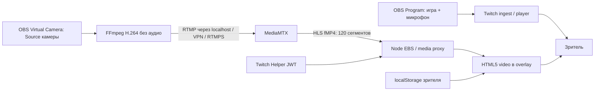

# Техническая проверка и архитектура

Проверено по официальной документации 5 ноября 2026. Факты платформы и инженерные решения ниже разделены.

## Проверенные возможности

- [Twitch security model](https://dev.twitch.tv/docs/extensions/): `media-src` допускает разрешённые медиадомены, `connect-src` — домены из URL Fetching allowlist. HTML5-видео не запрещено. Вложенные iframe запрещены; расширение само работает в изолированном iframe и не имеет доступа к DOM/таймлайну родительского плеера.
- [Policies](https://dev.twitch.tv/docs/extensions/guidelines-and-policies/), пункты 2.2, 2.4, 2.8–2.12: никаких вложенных iframe; звук по умолчанию выключен; Helper первым скриптом; все собственные скрипты внутри ZIP; все сетевые URL должны быть заявлены. Одобрение конкретного видеопродукта всё равно требует review Twitch.
- [Helper](https://dev.twitch.tv/docs/extensions/reference/): onAuthorized даёт EBS JWT; onContext содержит `hlsLatencyBroadcaster` в секундах; onVisibilityChanged сообщает о скрытии, паузах и рекламе. Это телеметрия, не API точного кадра и не сигнал точной синхронизации.
- [Design guidelines](https://dev.twitch.tv/docs/extensions/designing/): overlay масштабируется с плеером, находится ниже контролов Twitch, отключается офлайн и скрывается при паузе. Мобильный интерфейс расширения — отдельная поверхность; наличие мобильных Extensions не обещает desktop overlay поверх видео в приложении.
- [OBS Virtual Camera](https://obsproject.com/kb/virtual-camera-guide): может выводить отдельную Scene или Source независимо от Program. Поэтому не требуется второе Twitch-вещание и не нужен сторонний OBS plugin.
- [MediaMTX OBS](https://mediamtx.org/docs/publish/obs-studio): поддерживает RTMP(S) и WHIP. [HLS configuration](https://mediamtx.org/docs/references/configuration-file) позволяет хранить окно сегментов для перемотки. Сервер преобразует протоколы, но не выполняет автоматическое перекодирование.

## Выбор

| Вариант | Twitch | Синхронизация | Масштабирование |
|---|---|---|---|
| WebRTC / WHEP в overlay | Не считаем гарантированным: нужны отдельные испытания sandbox, ICE, CSP | Низкая задержка камеры усиливает расхождение; стандартный receiver не даёт DVR на десятки секунд | SFU, TURN и исходящий трафик на каждого зрителя |
| HLS в overlay — реализовано | Нативный video + hls.js без вложенных iframe; требуется review | Окно 120 сегментов, PDT, оценка Twitch + ручная поправка | Обычный HTTP, далее CDN |
| Отдельный сайт с Twitch embed — реализовано | Официальный Twitch embed вне Extension | Та же ручная калибровка; Helper там отсутствует | Та же HLS-доставка |
| Два собственных синхронных плеера | Это уже отдельная видеоплатформа | Общие capture timestamps и единый playback clock могут дать строгую синхронизацию | Доставка ещё и основного потока; не входит в этот MVP |

WHIP тоже включён на MediaMTX и доступен для отдельного издателя/OBS instance. Основной сценарий использует один OBS с Virtual Camera и небольшой FFmpeg-процесс. Простое дублирование Program на второй endpoint НЕ отделяет камеру; разные видеотреки OBS simulcast также не считаются независимыми сценами.

## Синхронизация

Камера всегда muted; микрофон идёт только с Twitch. Желаемая задержка: `L = clamp(Twitch latency или резервная задержка + поправка зрителя, 2, 90)`. При наличии HLS Program Date Time клиент переводит желаемый wall clock `Date.now() - L` в media time через `hls.playingDate`. Без PDT используется конец seekable-окна минус L. При ошибке более 1.5 секунды делается seek, при небольшой — playbackRate 0.97/1.03. Цель ограничивается доступным DVR; из отсутствующих сегментов кадры не восстановить. При скрытии overlay видео уничтожается и возобновляется при показе.

Это приблизительная синхронизация: RTMP arrival/PDT не равны общему capture timestamp камеры и игры; есть encoder/ingest задержка, часы сервера/клиента, джиттер, реклама, перемотка и изменения задержки Twitch. Нужен NTP, начальная визуальная/речевая калибровка и поправка зрителя. Safari native HLS использует относительную задержку от live edge. При рекламе/паузе Helper скрывает слой; standalone embed не имеет такого контроля и может продолжать камеру. Обещать lip-sync или точность до кадра нельзя.

## Авторизация и эксплуатация

Настройки стримера: HS256, base64 Extension Secret, обязательный exp, role=broadcaster, совпадение channel_id и user_id с каналом. Локальный ключ доступен только при NODE_ENV != production и только для LOCAL_CHANNEL_ID. Он не сохраняется в браузере. Издатель имеет уникальный HMAC-пароль канала; callback MediaMTX принимает только известные действия и пути. Callback закрыт от внешнего доступа Caddy; медиа-сервер не публикует HLS-порт наружу. Read-секрет знает только backend. Включённая камера публична: модель не предназначена для приватных/платных эфиров. CORS не является защитой авторизации.

Текущий proxy — один origin, конфигурация на диске и проверка enabled для каждого сегмента. Это подходит для малого развёртывания; тысячи зрителей требуют CDN/edge authorization, кеширования конфигурации, лимитов соединений и измерений. API rate limit не ограничивает медиатрафик. Перед включением CDN нужно отдельно настроить ключи кеша, TTL плейлистов и отключение доступа: сейчас намеренно `Cache-Control: no-store`.

При 1.2 Мбит/с камера даёт примерно 0.54 ГБ/зритель-час (десятичные единицы), 1000 зрителей — 1.2 Гбит/с и 540 ГБ/час, плюс overhead. Стоимость = объём × тариф провайдера; тарифы не фиксируем. HLS-окно около 18 МБ/канал при этом битрейте, плюс служебная память/буферы. MVP не содержит ABR renditions и не обещает нагрузочную готовность на тысячи зрителей.

Дальше: CDN, распределённое хранилище настроек/секретов, метрики исходящего трафика и budget alerts, NTP/clock calibration, измерение capture timestamps, отдельный строгий dual-stream player, hardware encoding, OBS plugin после проверки необходимости, мобильный отдельный UX.
